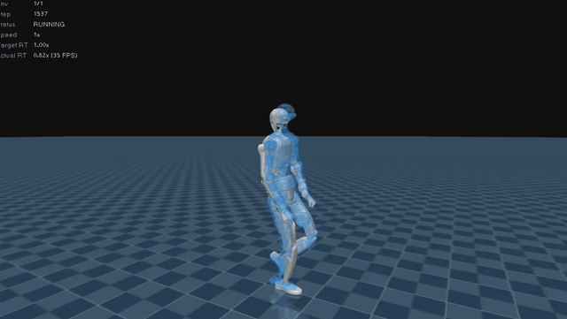

# SuperMimic_TienKung

English | [中文](README.zh-CN.md)

A standalone SuperMimic implementation for the Tiangong 3.0 (TienKung) humanoid robot. The repository includes the Tiangong robot model, a motion dataset, motion conversion tools, differentiable world-model training, policy playback, and evaluation. Trained weights (checkpoints) are not released.



## Requirements

- Linux
- Python 3.12
- NVIDIA GPU with a compatible CUDA driver
- [uv](https://docs.astral.sh/uv/)

```bash
git clone <your-repository-url> SuperMimic_TienKung
cd SuperMimic_TienKung
uv sync
```

Dependencies are pinned in `uv.lock`. `mjlab` is pinned to `8bb2bc9e187797689ec82c78c35019afd2fd0376`.

## Layout

```text
assets/tiangong3/              Tiangong 3.0 MuJoCo model and meshes
scripts/tiangong3/             Motion conversion, viewing, playback and evaluation scripts
src/tiangong_supermimic/       Training, environment, world model, policy and kinematics
data/npz/tiangong3/            Tiangong motion dataset (NPZ)
logs/                          Local training output (git-ignored)
```

## Motion Data

Training uses NPZ files in Tiangong joint order, located in `data/npz/tiangong3` by default.

### CSV to NPZ

Each CSV row contains root position `xyz`, root quaternion `xyzw`, and 31 Tiangong joint angles:

```bash
uv run python scripts/tiangong3/csv_to_npz.py \
  data/raw/lafan1/tiangong3 \
  --input-fps 30 \
  --output data/npz/tiangong3
```

The conversion resamples to 50 Hz and produces the root, joint and body states needed for training.

### Retargeting from LAFAN1 (optional)

`scripts/tiangong3/retarget_lafan1_gmr.py` requires an external [GMR](https://github.com/YanjieZe/GMR) workspace. Set its path with `GMR_ROOT`; by default a sibling `GMR` directory is used:

```bash
GMR_ROOT=/path/to/GMR uv run python scripts/tiangong3/retarget_lafan1_gmr.py
```

Run it in an environment with GMR's dependencies installed. Output goes to `data/raw/lafan1/tiangong3` by default.

### Viewing reference motions

```bash
uv run python scripts/tiangong3/view_motion.py walk1_subject1
# or pass a full path
uv run python scripts/tiangong3/view_motion.py data/npz/tiangong3/walk1_subject1.npz
```

## Training

```bash
uv run tg-sm-train
```

Common options:

```bash
uv run tg-sm-train \
  --data.npz-dir data/npz/tiangong3 \
  --env.num-envs 4096 \
  --env.collision-mode none \
  --device cuda:0 \
  --run-name tiangong3
```

Multi-GPU:

```bash
uv run torchrun --standalone --nproc-per-node=2 \
  -m tiangong_supermimic.scripts.train \
  --env.num-envs 512
```

Checkpoints are saved to `logs/tiangong3/<run-name>/`. To resume:

```bash
uv run tg-sm-train --resume logs/tiangong3/<run-name>/ckpt_latest.pt
```

## Playback and Evaluation

Play a policy:

```bash
uv run python scripts/tiangong3/play.py \
  --ckpt logs/tiangong3/<run-name>/ckpt_latest.pt \
  --npz-dir data/npz/tiangong3
```

Evaluate on the motion set:

```bash
uv run python scripts/tiangong3/eval_benchmark.py \
  --ckpt logs/tiangong3/<run-name>/ckpt_latest.pt \
  --npz-dir data/npz/tiangong3
```

## Collision Modes

Select with `--env.collision-mode` for training and `--collision` for `play.py` / `eval_benchmark.py`. The default is `none`.

| Mode | Collision geometry | Self-collision | Envs on a 24 GB GPU |
|---|---|---|---|
| `none` | Simplified convex hulls, ground contact only | Off | 16384 |
| `simplified` | One simplified convex hull per part | On | 8192 |
| `mesh` | Original meshes (treated as convex hulls) | On | 4096 |

Adjacent parts are excluded from self-collision; see `SELF_COLLISION_EXCLUDES` in `src/tiangong_supermimic/robot.py`.

Add `--colliders` to `play.py` to show colliders in translucent red, and `--no-ghost` to hide the blue reference motion.

## License

MIT, see [LICENSE](LICENSE). Redistribution and use of the Tiangong model and meshes are also subject to the license and terms of their original source.
